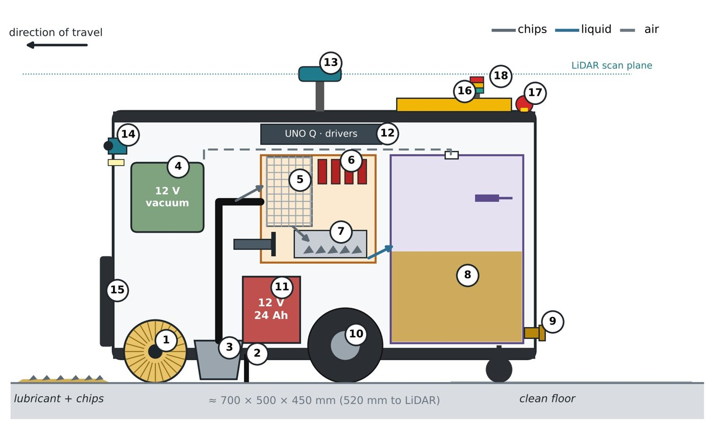
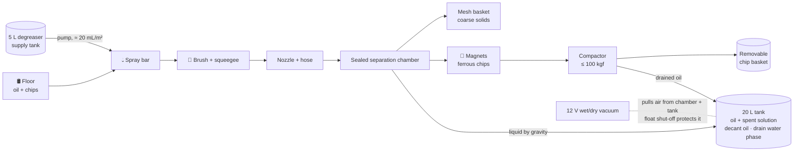
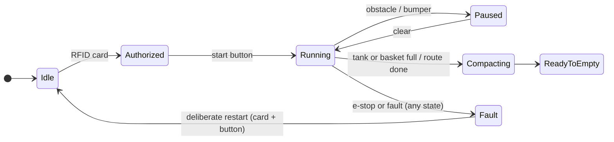
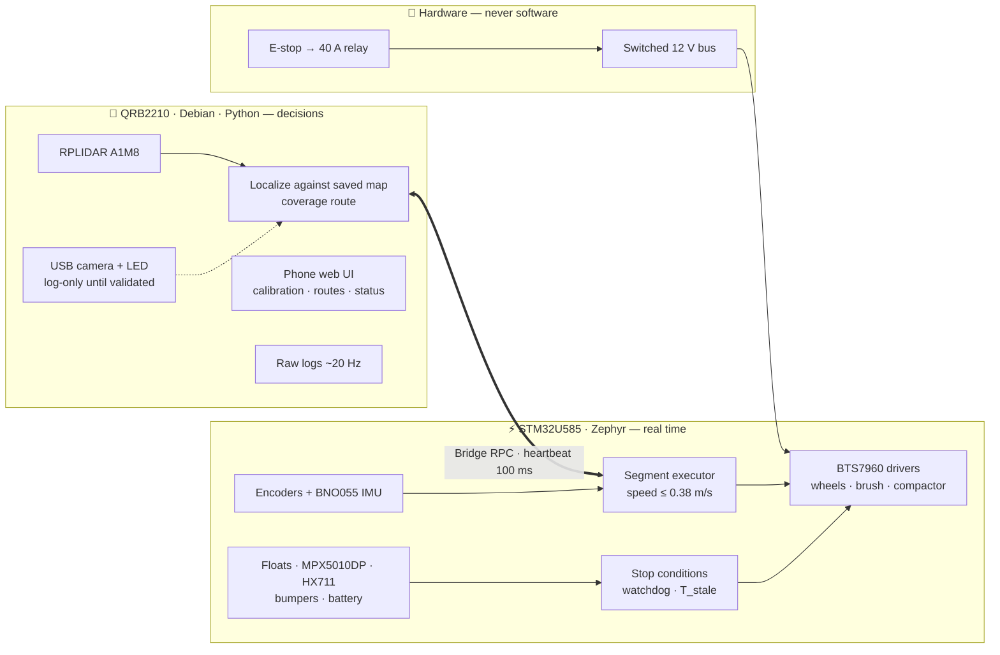
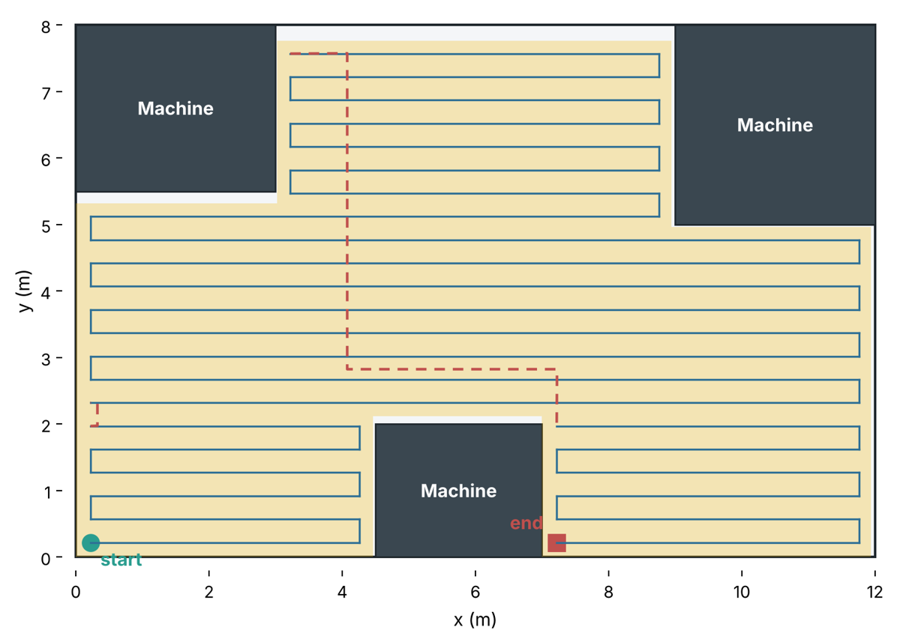

<div align="center">

# 🤖 Autonomous Industrial Waste Cleaning and Separation Robot

### Proyecto Mecatrónico I/II · Universidad Panamericana · Arduino UNO Q (STM32U585 + Qualcomm QRB2210)


[](https://github.com/Happenedspice17/industrial-waste-clean-machine/actions/workflows/ci.yml)
[](LICENSE)

**[📊 Final presentation (12 slides)](docs/semester-1-deliverables/Final_Presentation_Waste_Robot_v4.pptx)** ·
**[📄 Improved proposal](docs/semester-1-deliverables/Improved_Proposal_Waste_Robot.pdf)** ·
**[🧭 Project context](docs/00-project-context.md)** · **[📝 Changelog](CHANGELOG.md)**



*A ≈ 700 × 500 × 450 mm differential-drive robot that cleans oil and metal chips from a machining-plant floor during
the shift change, separates the ferrous fraction and coarse solids on board, compacts the chips and delivers
**two separate waste streams**: recovered lubricant and drained, compacted chips.*

</div>

---

## 🚦 Project status

| | |
|---|---|
| **Phase** | 🟠 **Initial design — not frozen** |
| **Next gate** | 🌀 **Suction rig** ([TP-S02](docs/test-reports/TP-S02-suction-rig-wet-trap.md)): brush + degreaser dose + wet trap, option A vs B ([ADR-0004](docs/adr/0004-collection-architecture.md)) |
| **Physical tests** | One exploratory suction pre-test ([TP-S01](docs/test-reports/TP-S01-handheld-suction-pretest.md), 2026-11-24): handheld vacuum without brush — suction alone fails, a degreaser helps → low-dose degreaser adopted ([ADR-0008](docs/adr/0008-cleaning-agent-dosing.md)). The brush concept is not tested yet. Other numbers are calculations, estimates or simulations |
| **Done so far** | Requirements, component selection, conceptual design, 9 modules, priced BOM, scenarios, economics, simulations, final presentation v4 (IEEE 7000 values, Business Model Canvas, first suction test), cleaning-agent decision (ADR-0008) |
| **Bench software** | AprilTag camera localization app on the UNO Q ([ADR-0007](docs/adr/0007-apriltag-bench-localization.md), [TP-V02](docs/test-reports/TP-V02-apriltag-localization.md)): simulation + unit tests only, physical accuracy test pending |
| **Checks** | Traceability, DFMEA + SCCAF, WCCA, lint and unit tests run on every PR (`python tools/check_all.py`) |

---

## 👥 Team

| Member | |
|---|---|
| **Franco Zavala Morgan** | **María Ruiz Mejía** |
| **Manuel Harari López** | **Ian Carlo Olivares Chávez** |
| **Carlos Emiliano Escamilla Garibay** | **Luis Roberto Sánchez Salgado** |
| **Juan Manuel Vásquez Paniagua** | |

**Advisor:** Dr. Hiram Eredín Ponce Espinosa · Faculty of Engineering, Universidad Panamericana (Mexico)

---

## 📚 Documentation

| Document | For | Content |
|---|---|---|
| 🧭 [**Project context**](docs/00-project-context.md) | Everyone | Requirements, modules, BOM, interfaces, metrics, scenarios, economics, open decisions |
| 🎓 [**Lessons learned**](docs/01-lessons-learned.md) | Engineering | 21 rules from our previous UNO Q robot, applied by default |
| 🧠 [**Architecture**](docs/02-architecture.md) | Engineering | MCU/Linux split, protocol, states, sensor roles, safety chain |
| ⚖️ [**Standards matrix**](docs/03-standards-matrix.md) | Safety / compliance | ISO 3691-4, NOM-001-STPS-2008 and more, with clauses and evidence |
| 💼 [**Business**](docs/04-business.md) · 🌱 [**Sustainability**](docs/05-sustainability-sdg.md) | Evaluation | Canvas, economics, SWOT, impact, SDGs |
| 🛡️ [**Internal SCCAF**](docs/08-sccaf.md) | Quality | Special characteristics YC/YS → CC/SC |
| 🔐 [**Threat model**](docs/security/threat-model.md) | Security | STRIDE per data flow for the camera app, web page, log and Bridge |
| 🧪 [**Test protocols and reports**](docs/test-reports/) | Validation | TP-V01 vision, TP-V02 AprilTag localization: pass criteria fixed before testing |
| 📖 [**Glossary**](docs/07-glossary.md) | Everyone | Definitions and project lingo |
| 🧾 [**Decision records**](docs/adr/) · 📙 [**Engineering log**](docs/engineering-log/) | Engineering process | Why each decision was made; one entry per stage |
| 📝 [**Changelog**](CHANGELOG.md) | Everyone | Every PR: what changed, how it was validated, IDs touched |
| 🗂️ [**Semester-1 deliverables**](docs/semester-1-deliverables/) | Course | Proposal, conceptual design, models, scenarios, impact, standards table, final presentation (v1 full, v2 10-slide, v3 + BMC, **v4 current** + suction test and degreaser) |

---

## 🎯 The problem

Machining shops, foundries and metal-forming lines accumulate **oil, coolant and metal chips** on their floors.
Cleaning during production is unsafe, so contamination stays on walkways until a stoppage.

| | |
|---|---|
| **USD 1.20 B / year** | Cost of same-level falls in U.S. manufacturing, the 2nd most costly injury cause (Liberty Mutual WSI 2023) |
| **290,527** | Work accidents in Mexico in 2023 (STPS/IMSS) |
| **NOM-001-STPS-2008 7.4** | Floors must be free of liquids that cause slips or falls |
| **≈ USD 75,000** | Commercial autonomous scrubber — cleans with water and **does not separate waste** |

The challenge is not driving around: it is **picking up dense steel chips and oil with a 12 V vacuum, separating
them on board and never mixing the two streams**, safely, with people and forklifts nearby.

---

## 💡 How it works





---

## 🧠 Architecture: two processors, two timing domains



| Domain | What runs there | Rule |
|---|---|---|
| **Real time** (STM32) | Motor + encoder loops, tool sequencing, floats, vacuum, force, bumpers, watchdog | Executes one segment and **stops by itself**; if Linux is late, the robot stops |
| **Decision** (Linux) | LiDAR localization, coverage route, vision, web UI, logging | Decides; never drives actuators directly |
| **Hardware** | E-stop relay, fuses, float shut-off, slipping brush belt | **Safety never depends on software** |

### 🧩 Nine modules

| Module | Function | Main components | Listed MXN |
|---|---|---|---:|
| M1 Chassis | Carries modules | 2040 aluminum profile, panels, bumper bar, leak tray | 1,276.00 |
| M2 Mobility | Differential drive | 2× JGB37-3530 + encoders, Talon 124 mm wheels, 2× BTS7960 | 3,011.00 |
| M3 Collection | Wet + loosen + pick up | Degreaser spray (5 L tank, 12 V pump), nylon brush (775 motor), squeegee, PETG nozzle, oil hose, 80 W vacuum, MPX5010DP | 1,472.00 + ≈ 1,000 dosing (estimate) |
| M4 Separation | Retain + compact | Stainless basket, 10× neodymium magnets, 150 kgf actuator, load cell + HX711 | 1,087.00 |
| M5 Storage | Hold liquid | 20 L tank, ½" ball valve, floats, float shut-off | 369.00 |
| M6 Perception | Localize + detect | RPLIDAR A1M8, BNO055, USB camera + LED, 4 bumpers | 4,232.00 |
| M7 Control | Compute | Arduino UNO Q 2 GB, MOSFET / level-shift boards | 1,122.00 |
| M8 Power + safety | Energy + hard stop | 12 V 24 Ah SLA, 2× XL4015, fuses, 2× 40 A relay, LAY37 e-stop | 2,619.00 |
| M9 Operator interface | Authorize + inform | RC522 RFID, lit button, 20×4 LCD, signal tower, web UI | 661.50 |
| **Total (32 items)** | | *≈ 21,310 with dosing, tooling and 15 % contingency* | **15,849.50** listed + ≈ 1,000 |

---

## 🛡️ Engineering validation toolkit

Every task leaves its evidence in the same PR ([definition of done](CLAUDE.md)), and CI checks it automatically.

| Method | What it answers | Where | Today |
|---|---|---|---|
| 📋 **Requirements + traceability** | Does every feature trace R → SR → test? | [`requirements.yaml`](requirements/requirements.yaml) | 10 stakeholder R · **25 SR** · checked in CI |
| ⚠️ **DFMEA / PFMEA** | How can it fail, how bad, how likely, how detected? | [`risk/dfmea.csv`](risk/dfmea.csv) · [`pfmea.csv`](risk/pfmea.csv) | **14 design + 3 process failure modes**, 5 with S ≥ 9 → mandatory actions |
| 🛡️ **SCCAF** | Which characteristics are critical, and is the control agreed? | [`risk/sccaf.csv`](risk/sccaf.csv) | **11 special characteristics**: 5 YC · 6 YS |
| ⚡ **WCCA** | Does every circuit work at the worst tolerance? | [`risk/wcca.yaml`](risk/wcca.yaml) | 9 checks: 8 ✅ · 1 ⚠️ |
| 🔩 **DFMA** | Can we build it with fewer parts and less time? | [`risk/dfma/`](risk/dfma/) | M4 first pass: DE 11.3 % → simplify |
| 💰 **Economic evaluation** | Is it worth it for a plant? | [`tools/econ.py`](tools/econ.py) | Payback 8.4 months (base, with degreaser) |
| 🔐 **Threat model** | Can someone misuse camera, web UI, RPC or RFID? | [`threat-model.md`](docs/security/threat-model.md) | Rev 1 (AprilTag app): **6 threats**, camera stream off by default |
| ⚖️ **Ethical design (IEEE 7000)** | Which values must the design protect, measurably? | [Final presentation v2](docs/semester-1-deliverables/Final_Presentation_Waste_Robot_v2.pptx) | EVR-01 safety · EVR-02 environment · EVR-03 privacy (draft, not yet in `requirements.yaml`) |
| 🧾 **ADR + engineering log** | Why did we decide this, with what evidence? | [`docs/adr/`](docs/adr/) · [`log`](docs/engineering-log/) | 8 ADRs |

### ⚠️ DFMEA — top risks (RPN = S × O × D)

| ID | Item | Failure mode | S | O | D | RPN | Class |
|---|---|---|:-:|:-:|:-:|:-:|:-:|
| F-001 | M3 vacuum unit | Cannot lift steel chips | 7 | 6 | 4 | **168** | YS |
| F-004 | M2 drive | Wheel slip on oil or soapy film | 8 | 5 | 4 | **160** | YS |
| F-010 | M4 chamber | Degreaser foam reaches the vacuum port | 8 | 5 | 4 | **160** | YS |
| F-011 | M3 squeegee + dosing | Wet soapy film left (slip) | 8 | 5 | 4 | **160** | YS |
| F-005 | M7 MCU/Linux link | Robot moves on a stale command | **9** | 4 | 3 | 108 | YC |
| F-008 | M6 vision | Wrong container level read | 5 | 5 | 4 | 100 | YS |
| F-002 | M5 tank | Liquid reaches the vacuum port | **9** | 3 | 3 | 81 | YC |
| F-006 | M4 compactor | Over-force / pinch | **9** | 3 | 3 | 81 | YC |
| F-003 | M8 e-stop | Relay contacts weld | **10** | 2 | 4 | 80 | YC |

The #1 risk is exactly why the design is not frozen: **can an 80 W 12 V vacuum lift steel chips?** The suction rig
answers it before anything else is built.

### 🛡️ SCCAF — special characteristics

Adapted from Ford's Special Characteristics Communication and Agreement Form. The class is **computed** from the
DFMEA, so it cannot drift; CI fails if a YC/YS row has no agreed control.

| DFMEA severity | Occurrence | Design class | Agreed class |
|---|---|---|---|
| 9–10 | any | 🔴 **YC** potential critical | **CC** critical: error-proofing or 100 % check |
| 5–8 | 4–10 | 🟡 **YS** potential significant | **SC** significant: measured check per build |
| 5–8 / 1–4 | 1–3 / any | — | Normal controls |

| SCCAF | Characteristic | Class | Control | Status |
|---|---|:-:|---|---|
| SC-001 | Chip lift rate at the nozzle (g/s) | 🟡 YS | Suction rig test before build | ⏳ open |
| SC-002 | Float shut-off closes before liquid reaches the vacuum | 🔴 YC | Overfill test 5× after every tank change | ⏳ open |
| SC-003 | Main relay rating vs worst-case inrush | 🔴 YC | WCCA + periodic e-stop test | ⏳ open |
| SC-004 | Vision container level agrees with floats | 🟡 YS | TP-V01 fill/drain cycles | ⏳ open |
| SC-005 | Stopping distance on oil from 0.38 m/s | 🟡 YS | Braking test 10× on reference oil | ⏳ open |
| SC-006 | MCU stops on heartbeat loss | 🔴 YC | Fault injection after every firmware release | ⏳ open |
| SC-007 | Compactor force limit + lid interlock | 🔴 YC | Load-cell log + interlock test | ⏳ open |

### ⚡ WCCA — worst-case circuit analysis

| Interface | Worst case | Status |
|---|---|:-:|
| Battery-sense divider → ADC | 2.06–2.97 V vs 3.1 V limit, **4.1 % margin** | ⚠️ tighten |
| Bumper switch → MCU logic | 0.89 V margin high and low | ✅ |
| HX711 DOUT → MCU logic | 0.59 V margin high and low | ✅ |
| Drive branch | 12 A peak · 15 A fuse · 14 AWG (15 A) | ✅ |
| Collection branch | 25 A peak · 20 A fuse · 12 AWG (20 A) | ✅ |
| Separation branch | 8 A peak · 10 A fuse · 16 AWG (10 A) | ✅ |
| Logic branch | 3 A peak · 5 A fuse · 18 AWG (7 A) | ✅ |
| Dosing pump branch | 2 A peak · 3 A fuse · 18 AWG (7 A) | ✅ |
| Runtime | 52 min at 165 W (with dosing pump) | ✅ |

*Analysis with datasheet tolerances; UNO Q supply limits are still to verify, then re-run with measured parts.*

### 🔩 DFMA and 💰 economics

| DFMA — M4 separation (first pass) | |
|---|---|
| Parts / theoretical minimum | 27 / 6 |
| Assembly time | 159 s |
| Design efficiency (3·Nmin/Σt) | **11.3 %** → merge parts and reduce fasteners before CAD |

| Economics (1 robot, 3 shifts, 900 cycles/yr) | Net benefit / yr | Payback | NPV (3 yr, 12 %) |
|---|---:|---:|---:|
| Optimistic | MXN 56,241 | 7.0 months | MXN 102,371 |
| **Base** | **MXN 46,731** | **8.4 months** | **MXN 79,529** |
| Pessimistic | MXN 15,879 | 37.1 months | **MXN −10,926** |

*Estimates, with the low-dose degreaser (ADR-0008): concentrate ≈ 2,510/yr and oily-water disposal ≈ 7,720/yr. Dry
concept (Activity 06) was 56,968/yr, 6.6 months, NPV 105,269. Biggest sensitivities: hours saved per day and the
dose — measure it in TP-S02.*

---

## 🔬 Engineering decisions (and why)

Each decision has a record with options, criteria and evidence in [`docs/adr/`](docs/adr/).

### 1. One board, two processors — [ADR-0001](docs/adr/0001-arduino-uno-q.md)
**Need:** real-time I/O (motors, encoders, HX711) *and* Linux workloads (LiDAR, vision, web UI, logs).
**Decision:** Arduino UNO Q 2 GB — the team already won 2nd place with it. **Consequence:** one USB-C port, so the
LiDAR and camera need a hub with its own power supply.

### 2. Split by timing, not by complexity — [ADR-0002](docs/adr/0002-split-by-timing.md)
**Lesson from the maze robot:** the MCU executes each motion order and stops by itself; Linux decides between
segments. Heartbeat every 100 ms; if it is lost, **the robot stops instead of driving on an old command**.

### 3. The e-stop is wired, not coded — [ADR-0003](docs/adr/0003-hardware-estop.md)
Mushroom e-stop in series with the main relay coil: all actuators lose power, logic stays on to report. Restart needs
the RFID card **and** the start button.

### 4. Suction first — [ADR-0004](docs/adr/0004-collection-architecture.md) · *open*
**A:** brush + vacuum carry oil and chips. **B:** brush throws chips into a front hopper; the vacuum takes only
liquid. Criteria are fixed before testing: choose A only if chip pickup ≥ 85 % with no clogging in 10 runs.
First evidence ([TP-S01](docs/test-reports/TP-S01-handheld-suction-pretest.md)): suction alone, no brush, lifted 0 of
5 coins dry and 2 of 5 with degreaser.

### 8. A little degreaser, still two streams — [ADR-0008](docs/adr/0008-cleaning-agent-dosing.md)
**Evidence:** TP-S01 — dry suction left the oil film untouched; a soap solution removed most of it. **Decision:** spray
≈ 20 mL/m² (estimate) of a low-foam, quick-break, non-flammable degreaser ahead of the brush. The solution tank is a
supply, so there are still two waste streams; the oil is decanted, the water phase goes to an authorized handler.
**New risks handled:** foam (SR-023), wet floor (SR-024), conductive liquid near electronics (IPX4), worker exposure
(SDS, PPE).

### 5. IMU without magnetometer — [ADR-0005](docs/adr/0005-imu-selection.md)
BNO055 in IMU mode: on-chip fusion, and no compass that steel machines would fool.

### 6. Vision assists, never drives — [ADR-0006](docs/adr/0006-vision-role.md)
**Lesson from the maze robot:** a glossy floor reflected the light and the camera saw walls that did not exist.
Here vision only **flags residue for a second pass** and **cross-checks container levels against the floats**, and
stays in log-only mode until protocol [TP-V01](docs/test-reports/TP-V01-vision-validation.md) passes on the real robot.

### 7. AprilTags as a bench tool — [ADR-0007](docs/adr/0007-apriltag-bench-localization.md)
**Need:** test pose estimation now, with one USB camera and printed tags, before the LiDAR stack exists.
**Decision:** `cv2.aruco` detector + planar (x, y, yaw) solver with the mount height and pitch fixed; ambiguous views
publish **no pose**; camera stream off by default. It is a bench tool only — navigation stays on LiDAR + encoders + IMU.

---

## 📊 Simulations and calculations

<div align="center">

</div>

| Item | Value | Evidence |
|---|---|---|
| Coverage of a 12 × 8 m cell with 3 machines | **96 %** of free floor in **25.6 min** → **167 m²/h**, 68 Wh/cycle | Simulation |
| Top speed | π · 0.124 m · 59 rpm / 60 ≈ **0.38 m/s** (0.15 m/s cleaning) | Calculation |
| Braking on oil (μ = 0.1) | ≤ **7.4 cm** from 0.38 m/s | Calculation |
| Energy | ≈ 165 W average (incl. dosing pump), 144 Wh usable → **≈ 52 min** | Estimate |

### ✅ Validated vs pending

| Aspect | Status | Next step |
|---|---|---|
| Coverage route | ✅ Simulation meets M3 (≥ 100 m²/h) | Repeat on a real floor (P4) |
| Speed, braking, energy | ✅ Calculations | Measure on the oily floor |
| Circuits | ⚠️ WCCA: battery-sense divider margin 4.1 % | Retune divider, re-run with measured parts |
| **Vacuum lifts steel chips** | ⏳ **Pending — design gate** | **Suction rig, weeks 1–3** |
| M1 recovery / M2 purity | ⏳ Pending | Weigh tank and basket, 1 m² patch |
| Safety (e-stop, heartbeat, floats, force) | ⏳ Pending | Tests linked to SC-002, SC-003, SC-006, SC-007 |
| Vision | ⏳ Log-only | TP-V01 |
| AprilTag bench localization | ⚠️ Simulation p90 0.09–0.11 m vs 0.10 m target | Calibrate camera, run TP-V02 on the bench |

---

## 🎓 Built on our previous robot

This team's [maze-solving robot](https://github.com/Happenedspice17/sumo-v-ia) (same Arduino UNO Q, **2nd place**)
gave us [21 lessons](docs/01-lessons-learned.md) that we apply by default:

- ⏱️ **Time is not distance** — references come from encoders, IMU and LiDAR, never open-loop timing.
- 🗳️ **One bad reading never changes state alone** — min-of-3, two-read confirmation, capped votes.
- 📏 **Thresholds at the midpoint of two measured readings**, never from CAD alone.
- 🧪 **Simulate before tuning, log every run raw** and make the simulator reproduce field failures.
- 📱 **Calibrate on site from a phone**, with the plant's own light.

---

## 🗂️ Repository layout

| Folder | Content |
|---|---|
| [`docs/`](docs/) | Context, architecture, standards, business, glossary, SCCAF, ADRs, engineering log, test protocols, deliverables |
| [`requirements/`](requirements/) | `requirements.yaml` — single source of truth (R1–R10 → SR-xxx) |
| [`risk/`](risk/) | DFMEA, SCCAF register, WCCA inputs, DFMA worksheets |
| [`tests/`](tests/) | Unit tests for the tools (app tests live next to their code) |
| [`tools/`](tools/) | Checkers and calculators: traceability, FMEA + SCCAF, WCCA, DFMA, economics, git policy |
| [`cad/`](cad/) | Parametric OpenSCAD parts (`lib/`, `parts/`, `params/`) |
| [`firmware/mcu/`](firmware/mcu/) · [`linux/`](linux/) | STM32U585 firmware (starts after the suction gate) · QRB2210 Python: AprilTag bench app today, navigation later |
| [`sim/`](sim/) | Coverage, noisy-sensor and log-replay simulators |
| [`.claude/`](.claude/) | Claude Code agents (DFMEA, WCCA, safety, cybersecurity, …), commands and safety hooks |

---

## 🚀 Getting started

```bash
git clone https://github.com/Happenedspice17/industrial-waste-clean-machine.git
cd industrial-waste-clean-machine
python -m venv .venv && . .venv/bin/activate        # Windows: .venv\Scripts\activate
pip install -e ".[dev]"
pre-commit install --hook-type pre-commit --hook-type commit-msg
python tools/check_all.py                           # traceability, DFMEA/SCCAF, WCCA, ruff, pytest
```

```bash
python tools/fmea.py risk/dfmea.csv                 # RPN ranking + YC/YS classes
python tools/wcca.py risk/wcca.yaml                 # worst-case circuits
python tools/dfma.py risk/dfma/m4_separation_example.csv
python tools/econ.py                                # payback, NPV, tornado
```

### 🔁 Workflow

1. **Requirement first** → `SR-xxx` in `requirements/requirements.yaml`.
2. **Branch** from `develop` → `<type>/<issue>-<short-desc>`.
3. **Validate and document in the same PR** → DFMA · DFMEA/PFMEA · SCCAF · WCCA · ISO/NOM · security · ADR · test
   report · engineering log · changelog entry, or "N/A" with the reason.
4. **Conventional Commit** (`feat(m3): …`, `Refs: SR-xxx`) → PR to `develop` → CI green → merge.
5. **Release** → `develop` into `main`.

---

## 🗺️ Roadmap

| Phase | Weeks | Goal |
|---|---|---|
| 🌀 P1 | 1–3 | **Suction rig** → decide A/B → freeze the design |
| 🔧 P2 | 3–7 | Build modules in 4 teams: chassis + mobility · separation + storage · power + safety + HMI · control + navigation + vision |
| 🔗 P3 | 7–10 | Integration; map, save and replay a route |
| 🧪 P4 | 10–13 | Validate M1–M3 and safety on an oily floor |
| 🏭 P5 | 13–16 | Plant pilot, customer interviews, final report |

---

## 🙏 Credits and AI use

**Authors.** The design, requirements, component selection, calculations, simulations, semester-1 deliverables and
every engineering decision belong to the team listed above, under the supervision of Dr. Hiram Eredín Ponce
Espinosa. The team is responsible for all content in this repository.

**Prior work.** The lessons learned, MCU/Linux split and vision approach come from the team's previous Arduino UNO Q
robot, a maze solver for *Microcontroladores 2* (2nd place):
[Happenedspice17/sumo-v-ia](https://github.com/Happenedspice17/sumo-v-ia).

**AI assistance.** Since August 2026 the team has used **Claude** (Anthropic) as a chat assistant during the design
phase. In November 2026 the team started using **Claude Code** (Anthropic) on this repository. Under the team's
direction it set up this repository from the team's kit, translated the Spanish deliverables to English,
drafted ADR-0006 (vision role) from the maze-robot history, requirements SR-015–SR-017, test protocol TP-V01, the
glossary, the internal SCCAF and its check in `tools/fmea.py`, this README and the cybersecurity agent, the
AprilTag bench app (ADR-0007, TP-V02, threat model) and the 10-slide final presentation with the IEEE 7000 EVRs. Commits it
helped write carry a `Co-Authored-By: Claude` trailer. Rules for AI output in this project:

- AI output is a draft: a team member reviews every change before it is merged.
- Numbers keep their evidence label (estimate, simulation, measured); AI never turns a simulation into a test result.
- Safety functions, thresholds and sign-offs (SCCAF, test reports) are decided and approved by people.

**References for AI tools**

- Anthropic. (2026). *Claude Code* [AI coding assistant]. https://claude.com/claude-code
- Anthropic. (2026). *Claude* [Large language model]. https://www.anthropic.com/claude

---

## 📄 License

Released under the [MIT License](LICENSE).
