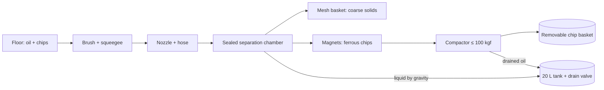

# Autonomous Industrial Waste Cleaning and Separation Robot

[](https://github.com/Happenedspice17/industrial-waste-clean-machine/actions/workflows/ci.yml)


[](LICENSE)

A compact autonomous mobile robot that cleans lubricant and metal chips from machining-plant floors during shift
changes, separates the ferrous fraction and coarse solids on board, compacts the chips, and delivers **two separate
waste streams**: recovered lubricant and drained, compacted chips.

Capstone project of *Proyecto Mecatrónico I/II* — Faculty of Engineering, Universidad Panamericana (Mexico), 2026–2027.

> **Project status (Nov 2026):** design phase complete — requirements, component selection, conceptual design,
> nine modules, priced BOM, scenario analysis, economics and simulations. **No physical prototype or test results
> yet.** Next semester: build and validate, starting with the suction rig ([ADR-0004](docs/adr/0004-collection-architecture.md)).

---

## Contents

- [The problem](#the-problem)
- [The solution](#the-solution)
- [System architecture](#system-architecture)
- [Key figures](#key-figures)
- [Safety by design](#safety-by-design)
- [Repository layout](#repository-layout)
- [Getting started](#getting-started)
- [Engineering workflow](#engineering-workflow)
- [Documentation](#documentation)
- [Roadmap](#roadmap)
- [Team](#team)
- [License](#license)

## The problem

Machining shops, foundries and metal-forming lines accumulate oil, coolant and metal chips on their floors. Cleaning
during production is unsafe, so contamination stays on walkways until a stoppage. Same-level falls cost U.S.
manufacturing about **USD 1.20 B per year** (Liberty Mutual WSI 2023), and NOM-001-STPS-2008 7.4 requires floors free
of liquids that cause slips. Commercial autonomous scrubbers (≈ USD 75,000 – MXN 2.0 M) clean with water and **do not
separate waste**.

## The solution

During each shift change the robot follows a stored route over the work cell:



A 12 V wet/dry vacuum pulls clean air from the sealed chamber and tank; a float shut-off protects it from liquid.
Operation is authorized with an RFID card and a start button, and status is shown on a signal tower, an LCD and a
phone web page.

## System architecture

**Controller:** Arduino UNO Q 2 GB — an STM32U585 MCU (Zephyr, real time) and a Qualcomm QRB2210 MPU (Debian Linux,
Python) linked by the Arduino Bridge. Work is split by timing requirement, not by complexity
([ADR-0002](docs/adr/0002-split-by-timing.md)):

| Domain | Responsibilities | Rule |
|---|---|---|
| MCU (real time) | Motor and encoder loops, tool sequencing, floats, vacuum, force, bumpers, watchdog | Executes one motion segment and stops by itself; stops if Linux is late |
| Linux (best effort) | LiDAR localization against a saved map, coverage route, vision, web UI, 20 Hz raw logging | Decides; never drives actuators directly |
| Hardware | E-stop relay, fuses, float shut-off, slipping brush belt | Never depends on software |

| Module | Function | Main components |
|---|---|---|
| M1 Chassis | Carries modules | 2040 aluminum profile, panels, bumper bar, leak tray |
| M2 Mobility | Differential drive | 2× JGB37-3530 gearmotors with encoders, 124 mm wheels, BTS7960 drivers |
| M3 Collection | Loosen and pick up | Nylon brush (775 motor), squeegee, PETG nozzle, oil hose, 80 W wet/dry vacuum, MPX5010DP |
| M4 Separation | Retain and compact solids | Stainless mesh basket, neodymium magnets, 150 kgf actuator, load cell + HX711 |
| M5 Storage | Hold liquid | 20 L tank, ball drain valve, floats, float shut-off |
| M6 Perception | Localize and detect | RPLIDAR A1M8, BNO055 IMU, USB camera + LED, 4 bumpers |
| M7 Control | Compute | Arduino UNO Q, MOSFET and level-shifting boards |
| M8 Power + safety | Energy and hard stop | 12 V 24 Ah SLA, buck converters, fuses, 40 A relays, e-stop |
| M9 Operator interface | Authorize and inform | RC522 RFID, lit start button, 20×4 LCD, signal tower, web UI |

Vision is advisory only: a residue check and a container-level cross-check that stay in log-only mode until
validated on the real robot ([ADR-0006](docs/adr/0006-vision-role.md)).

## Key figures

Every number carries its evidence level; nothing here is a physical test result yet.

| Item | Value | Evidence |
|---|---|---|
| Target metrics | M1 recovery ≥ 85 % · M2 purity ≥ 95 % liquid / ≥ 90 % solids · M3 coverage ≥ 100 m²/h, 0 incidents | Acceptance criteria |
| Coverage, 12 × 8 m cell | 96 % of free floor, 25.6 min, 167 m²/h, 68 Wh per cycle | Simulation |
| Speed | ≤ 0.38 m/s (0.15 m/s cleaning); braking ≤ 7.4 cm on oil (μ = 0.1) | Calculation |
| Energy | ≈ 160 W average, 144 Wh usable → ≈ 55 min per charge | Estimate |
| Envelope | ≈ 700 × 500 × 450 mm (520 mm to LiDAR) | Design |
| Listed BOM | MXN 15,849.50 (≈ 20,160 with tooling and 15 % contingency) | Supplier quotes, Oct 2026 |
| Economics (1 robot, 3 shifts) | Net benefit MXN 56,968/yr · payback 6.6 months · NPV (3 yr, 12 %) MXN 105,269 | Estimate |

## Safety by design

- **Hardware emergency stop:** the e-stop opens the main relay coil and removes power from every actuator; restart
  requires an RFID card and the start button ([ADR-0003](docs/adr/0003-hardware-estop.md)).
- **Fail-safe control link:** the MCU stops all motion if the Linux heartbeat is lost.
- **Physical limits:** float shut-off at the vacuum port, compactor force limit with lid interlock, current limits,
  fuse per branch, speed limit with overspeed detection.
- **Special characteristics:** DFMEA rows with severity ≥ 5 are classed YC/YS and tracked to an agreed control in the
  internal SCCAF ([docs/08-sccaf.md](docs/08-sccaf.md)).
- **Standards in scope:** ISO 3691-4:2023, NOM-001-STPS-2008, ISO 12100, ISO 13849-1, ISO 13850, IEC 60204-1,
  IEC 60529, NOM-052-SEMARNAT-2005 ([docs/03-standards-matrix.md](docs/03-standards-matrix.md)).

## Repository layout

```
├── cad/             Parametric OpenSCAD parts (lib/, parts/, params/)
├── docs/            Context, architecture, standards, business, glossary, SCCAF, ADRs, engineering log, deliverables
├── firmware/mcu/    STM32U585 firmware (Zephyr / Arduino core)
├── linux/           QRB2210 Python app (navigation, web UI, logging, vision)
├── requirements/    requirements.yaml — single source of truth (R1–R10 → SR-xxx)
├── risk/            DFMEA, SCCAF register, WCCA data
├── sim/             Coverage, noisy-sensor and log-replay simulators
├── tests/           Unit tests for the tools
├── tools/           Checkers and calculators (traceability, FMEA, WCCA, DFMA, economics, git policy)
└── .claude/         Claude Code agents, commands and safety hooks
```

## Getting started

Requirements: Python 3.11+, Git. OpenSCAD only for CAD work.

```bash
git clone https://github.com/Happenedspice17/industrial-waste-clean-machine.git
cd industrial-waste-clean-machine
python -m venv .venv && . .venv/bin/activate        # Windows: .venv\Scripts\activate
pip install -e ".[dev]"
pre-commit install --hook-type pre-commit --hook-type commit-msg
python tools/check_all.py                           # branch, traceability, FMEA/SCCAF, WCCA, ruff, pytest
```

Useful calculators: `python tools/fmea.py risk/dfmea.csv` (RPN ranking and YC/YS classes) ·
`python tools/wcca.py risk/wcca.yaml` · `python tools/econ.py` · `python tools/dfma.py <worksheet.csv>`.

## Engineering workflow

1. **Requirement first** — every feature, part and test traces to an `SR-xxx` in `requirements/requirements.yaml`.
2. **Branch** from `develop`: `<type>/<issue>-<short-desc>` (e.g., `feature/12-suction-rig-logger`).
3. **Validate and document in the same PR** — the definition of done in [CLAUDE.md](CLAUDE.md) lists what each task
   needs: DFMA, DFMEA/PFMEA, SCCAF entry, WCCA, ISO/NOM check, ADR, test protocol and report, engineering log entry.
4. **Commit** with Conventional Commits (`feat(m3): …`, body `Refs: SR-xxx`) and open a PR to `develop`; CI must pass.
5. **Release** by merging `develop` into `main`.

Details: [CONTRIBUTING.md](CONTRIBUTING.md) and [docs/06-github-setup.md](docs/06-github-setup.md).

## Documentation

| Document | Contents |
|---|---|
| [00 · Project context](docs/00-project-context.md) | Requirements, modules, BOM, interfaces, metrics, scenarios, economics, open decisions |
| [01 · Lessons learned](docs/01-lessons-learned.md) | 21 rules from the team's previous UNO Q robot, applied by default |
| [02 · Architecture](docs/02-architecture.md) | MCU/Linux split, protocol, states, sensor roles, safety chain |
| [03 · Standards matrix](docs/03-standards-matrix.md) | ISO / IEC / NOM clauses and evidence |
| [04 · Business](docs/04-business.md) | Business Model Canvas, economics, SWOT, technological impact |
| [05 · Sustainability](docs/05-sustainability-sdg.md) | SDG mapping and environmental impact method |
| [06 · GitHub setup](docs/06-github-setup.md) | Branch model, CI checks, protection rules |
| [07 · Glossary](docs/07-glossary.md) | Definitions and project lingo |
| [08 · Internal SCCAF](docs/08-sccaf.md) | Special characteristics (YC/YS → CC/SC) |
| [Decision records](docs/adr/) | ADR-0001 to ADR-0006 |
| [Engineering log](docs/engineering-log/) | One entry per stage |
| [Semester-1 deliverables](docs/semester-1-deliverables/) | Proposal, conceptual design, models, scenarios, impact, presentation |

## Roadmap

| Phase | Weeks | Goal |
|---|---|---|
| P1 | 1–3 | Suction rig; decide collection architecture A/B |
| P2 | 3–7 | Build modules in four teams (chassis + mobility · separation + storage · power + safety + HMI · control + navigation + vision) |
| P3 | 7–10 | Integration; map, save and replay a route |
| P4 | 10–13 | Validation of M1–M3 and safety tests on an oily floor |
| P5 | 13–16 | Plant pilot, customer interviews, final report |

## Team

Franco Zavala Morgan · María Ruiz Mejía · Manuel Harari López · Ian Carlo Olivares Chávez ·
Carlos Emiliano Escamilla Garibay · Luis Roberto Sánchez Salgado · Juan Manuel Vásquez Paniagua

**Advisor:** Dr. Hiram Eredín Ponce Espinosa — Universidad Panamericana

## License

Released under the [MIT License](LICENSE).
