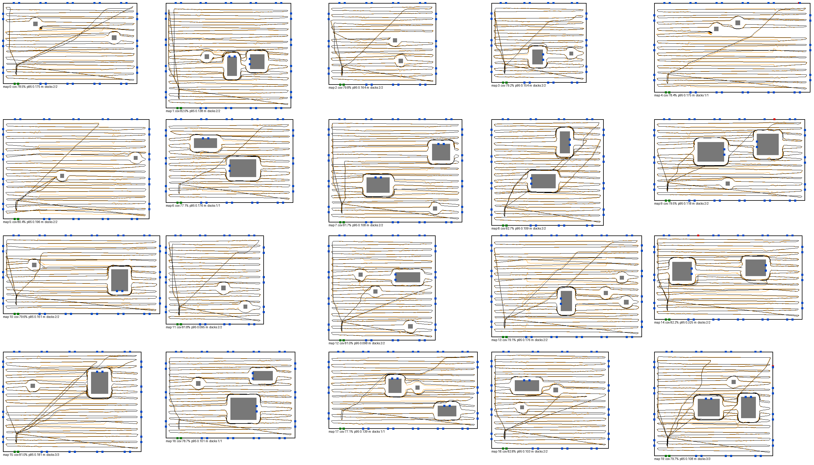

# Whole-mission simulation over 20 plant cells (2026-11-22)

**Simulation only, not physical evidence (rule 4).** Command:
`python sim/plant_sim.py --maps 20 --seed 0 --jobs 4 --docs` (≈ 10 min on 4 cores). Code under test is the real
`Localizer` (SR-018, SR-019), `Caution` (SR-020), `Docking` (SR-023) and the Python mirror of the firmware level
filter (SR-022). Refs: ADR-0007, ADR-0008, ADR-0009, ADR-0010.

Black: true path · orange: estimated path · grey: machines and columns · blue: tag stations (pairs) · green: home
pair · red: a tag moved after the survey (map not updated).

## Model (assumptions, all estimates)
- Cell 10–18 × 8–12 m, 2–5 machines or columns, 1–3 people walking at 1 m/s who step away from the robot within
  1.2 m. Tag stations (2 × 160 mm tags, 0.60 m apart, 0.9 m high) every ≈ 3 m on walls and on one face of each
  machine ≥ 0.8 m; home pair (0.40 m apart) on the y = 0 wall; dock 1.0 m in front.
- One forward camera, 640 × 480, 60° HFOV, 0.45 m high, 15° up, 2 Hz in the simulator; tags visible within FOV,
  ≤ 6 m, ≤ 75° view angle, ≥ 12 px, not occluded by machines or people; 3 % missed detections; 0.4 px corner noise;
  1 % of tags with one 3 px outlier corner.
- Odometry: wheel scale error 1 % (σ), IMU heading bias random walk 0.3°/√min plus slow drift. No LiDAR scan match
  (pessimistic: tags are the only re-anchor).
- Route: boustrophedon, lanes 0.35 m apart (0.40 m nozzle, 5 cm overlap), clearance 0.10 m from machines, 0.15 m/s
  cleaning, 0.30 m/s transit; A* between lanes and to home.
- MCU model: stops for a person within 0.6 m ahead (60° cone) and at the LiDAR stop distance from machines; Linux
  backs off 0.3 m and replans after 3 s blocked. Caution caps the request at 0.10 m/s.
- Tank fills with cleaned area (full after 50–140 % of the cell, random per map); ultrasonic reading with 4 mm noise
  through the level filter; return home on FULL, empty for 60 s, resume; return home at the end.

## Results
- Maps: 20; completed: 20
- Coverage %: mean 80.1, min 77.1
- Pose error p95 (m): median 0.147, worst 0.325; max over all maps 0.603
- Odometry-only end error (m): median 0.35, worst 0.55
- Person contacts while moving: 0; machine hits: 0
- Dockings: 38 ok, 0 failed; worst final error 0.055 m
- Returns on FULL level: 18
- Bad fixes from moved tags: 0 (maps with a moved tag: 4)

| Map | Cell m | Mach. | People | Moved tag | Cover % | Pose p95 m | Pose max m | Odom-only end m | Multi-tag frames % | Longest no fix m | Caution % | Contacts | Machine hits | Recoveries | Full returns | Docks ok | Docks failed | Dock err max m | Bad fixes moved tag | Min |
|---|---|---|---|---|---|---|---|---|---|---|---|---|---|---|---|---|---|---|---|---|
| 0 | 15.1x9.1 | 2 | 3 | -1 | 78.5 | 0.175 | 0.405 | 0.37 | 13.2 | 48.4 | 22.3 | 0 | 0 | 60 | 1 | 2 | 0 | 0.046 | 0 | 54.0 |
| 1 | 14.1x11.8 | 3 | 3 | -1 | 82.0 | 0.138 | 0.274 | 0.45 | 15.9 | 14.1 | 21.1 | 0 | 0 | 8 | 1 | 2 | 0 | 0.038 | 0 | 57.1 |
| 2 | 12.1x9.2 | 2 | 3 | -1 | 79.8 | 0.164 | 0.245 | 0.26 | 16.6 | 32.2 | 29.1 | 0 | 0 | 42 | 1 | 2 | 0 | 0.055 | 0 | 43.2 |
| 3 | 10.7x8.9 | 2 | 1 | -1 | 79.2 | 0.154 | 0.285 | 0.16 | 25.5 | 8.9 | 10.4 | 0 | 0 | 0 | 1 | 2 | 0 | 0.038 | 0 | 30.5 |
| 4 | 17.5x10.0 | 2 | 3 | 16 | 78.4 | 0.175 | 0.222 | 0.55 | 10.0 | 25.8 | 19.3 | 0 | 0 | 33 | 0 | 1 | 0 | 0.046 | 0 | 57.6 |
| 5 | 16.4x11.2 | 2 | 2 | -1 | 80.4 | 0.196 | 0.459 | 0.53 | 13.8 | 21.2 | 11.7 | 0 | 0 | 1 | 1 | 2 | 0 | 0.044 | 0 | 60.4 |
| 6 | 14.3x9.4 | 2 | 1 | -1 | 77.1 | 0.176 | 0.354 | 0.27 | 16.4 | 12.7 | 5.5 | 0 | 0 | 1 | 0 | 1 | 0 | 0.045 | 0 | 38.8 |
| 7 | 15.0x11.6 | 3 | 2 | -1 | 81.7 | 0.108 | 0.225 | 0.49 | 14.4 | 12.7 | 12.9 | 0 | 0 | 1 | 1 | 2 | 0 | 0.044 | 0 | 55.8 |
| 8 | 12.6x11.9 | 2 | 1 | -1 | 82.7 | 0.109 | 0.264 | 0.33 | 20.9 | 10.2 | 10.4 | 0 | 0 | 1 | 1 | 2 | 0 | 0.033 | 0 | 50.2 |
| 9 | 17.0x9.1 | 3 | 3 | 19 | 79.5 | 0.118 | 0.277 | 0.44 | 17.0 | 14.4 | 20.3 | 0 | 0 | 0 | 1 | 2 | 0 | 0.047 | 0 | 51.2 |
| 10 | 17.6x8.8 | 2 | 2 | -1 | 79.6 | 0.161 | 0.292 | 0.43 | 13.1 | 14.3 | 16.0 | 0 | 0 | 1 | 1 | 2 | 0 | 0.04 | 0 | 50.8 |
| 11 | 11.0x10.0 | 2 | 2 | -1 | 81.8 | 0.095 | 0.295 | 0.19 | 18.6 | 9.4 | 20.1 | 0 | 0 | 0 | 1 | 2 | 0 | 0.042 | 0 | 37.7 |
| 12 | 12.0x11.8 | 4 | 3 | -1 | 81.0 | 0.098 | 0.316 | 0.32 | 19.6 | 9.5 | 21.5 | 0 | 0 | 1 | 1 | 2 | 0 | 0.05 | 0 | 47.1 |
| 13 | 16.9x11.4 | 4 | 2 | -1 | 79.1 | 0.176 | 0.382 | 0.53 | 14.5 | 16.0 | 11.9 | 0 | 0 | 0 | 1 | 2 | 0 | 0.04 | 0 | 62.2 |
| 14 | 16.6x9.4 | 2 | 3 | 25 | 82.2 | 0.325 | 0.603 | 0.37 | 16.0 | 14.3 | 18.1 | 0 | 0 | 3 | 1 | 2 | 0 | 0.042 | 0 | 51.9 |
| 15 | 15.5x11.3 | 2 | 2 | -1 | 81.0 | 0.181 | 0.323 | 0.52 | 15.7 | 14.4 | 13.9 | 0 | 0 | 7 | 2 | 3 | 0 | 0.053 | 0 | 60.9 |
| 16 | 14.5x9.7 | 3 | 3 | -1 | 78.7 | 0.101 | 0.261 | 0.24 | 18.2 | 11.8 | 21.4 | 0 | 0 | 0 | 0 | 1 | 0 | 0.037 | 0 | 43.0 |
| 17 | 16.8x8.6 | 3 | 1 | -1 | 77.1 | 0.139 | 0.266 | 0.33 | 12.8 | 15.2 | 6.9 | 0 | 0 | 1 | 0 | 1 | 0 | 0.044 | 0 | 43.1 |
| 18 | 13.2x10.9 | 3 | 1 | -1 | 82.8 | 0.103 | 0.228 | 0.34 | 18.5 | 10.8 | 9.8 | 0 | 0 | 1 | 1 | 2 | 0 | 0.043 | 0 | 46.9 |
| 19 | 13.4x11.7 | 3 | 3 | 12 | 79.7 | 0.108 | 0.22 | 0.33 | 16.2 | 17.6 | 21.5 | 0 | 0 | 3 | 2 | 3 | 0 | 0.052 | 0 | 54.3 |

## Findings
1. **Moved tag seen alone (fixed before this run).** The first run gave 31 bad fixes (> 0.3 m) in 2 of 4 maps with a
   moved tag: the same tag seen on 2 consecutive frames confirmed its own jump. The localizer now needs a
   **different** tag to confirm a single-tag jump; the rerun above has 0 bad fixes (SR-019 acceptance,
   `test_moved_tag_seen_alone_never_moves_the_pose`).
2. **No person contact and no machine hit** in 20 maps, with caution active 6–29 % of the time.
3. **Docking 38 / 38**, worst final error 0.055 m — slightly above the 0.05 m SR-023 limit: the dock check uses the
   estimated pose, whose error at 1 m from the home pair is ≈ 0.01–0.05 m. TP-N01 must measure this; tighten the
   dock tolerance or add a contact/LiDAR check if the real error is similar.
4. **Coverage 77–83 % of reachable floor** (not the 96 % of the semester-1 ideal model): pose error between fixes
   (p95 ≈ 0.10–0.33 m) leaves gaps between 0.35 m lanes, and LiDAR stop recoveries near machines skip short pieces.
   One camera facing forward sees a station in 10–26 % of frames; the longest stretch without any fix was 9–48 m.
   Expected gains, to simulate next: LiDAR scan matching (already in the architecture), more cameras (4 planned),
   tighter lane overlap.
5. Odometry alone would end 0.16–0.55 m off after one mission in this model.

## Limits
People and occlusions are simplified; no glare, motion blur, oil on tags or lighting changes; HOG detection is
modelled as 85 % detection with rare false positives, not run on images; the ultrasonic model has no foam or probe
fouling. Real values come from TP-V02, TP-V03, TP-L01 and TP-N01.
