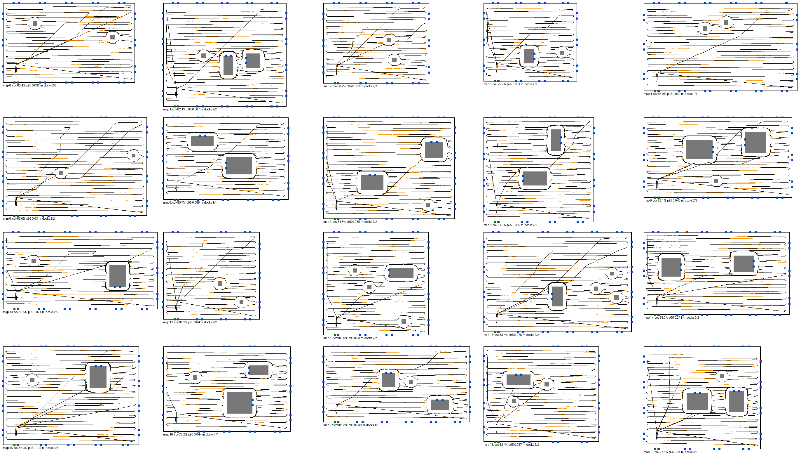

# Whole-mission simulation over 20 plant cells (2026-11-22)

**Simulation only, not physical evidence (rule 4).** Command:
`python sim/plant_sim.py --maps 20 --seed 0 --jobs 4 --docs` (≈ 10 min on 4 cores). Code under test is the real
`Localizer` (SR-018, SR-019), `Caution` (SR-020), `Docking` (SR-023) and the Python mirror of the firmware level
filter (SR-022). Refs: ADR-0007, ADR-0008, ADR-0009, ADR-0010.

Four sensor rigs over the same 20 cells (`--rig`): one front camera, front + rear cameras, four cameras, and one
camera + LiDAR (idealised scan match). Decision in ADR-0011.

Black: true path · orange: estimated path · grey: machines and columns · blue: tag stations (pairs) · green: home
pair · red: a tag moved after the survey (map not updated). Other rigs: `plant-sim-montage-{front,quad,lidar_front}.png`.

## Model (assumptions, all estimates)
- Cell 10–18 × 8–12 m, 2–5 machines or columns, 1–3 people walking at 1 m/s who step away from the robot within
  1.2 m. Tag stations (2 × 160 mm tags, 0.60 m apart, 0.9 m high) every ≈ 3 m on walls and on one face of each
  machine ≥ 0.8 m; home pair (0.40 m apart) on the y = 0 wall; dock 1.0 m in front.
- Cameras 640 × 480, 60° HFOV, 0.45 m high, 15° up, 2 Hz in the simulator (front at +0.20 m; rear at −0.30 m
  facing back; side cameras at ±0.22 m for the 4-camera rig); tags visible within FOV,
  ≤ 6 m, ≤ 75° view angle, ≥ 12 px, not occluded by machines or people; 3 % missed detections; 0.4 px corner noise;
  1 % of tags with one 3 px outlier corner.
- Odometry: wheel scale error 1 % (σ), IMU heading bias random walk 0.3°/√min plus slow drift. No LiDAR scan match
  (tags are the only re-anchor except in the LiDAR rig: scan-match fix σ 3 cm / 0.5°, 10 % failures, optimistic).
- Navigator fuses each accepted fix with dead reckoning by variance (`linux/nav/fusion.py`).
- Route: boustrophedon, lanes 0.35 m apart (0.40 m nozzle, 5 cm overlap), clearance 0.10 m from machines, 0.15 m/s
  cleaning, 0.30 m/s transit; A* between lanes and to home.
- MCU model: stops for a person within 0.6 m ahead (60° cone) and at the LiDAR stop distance from machines; Linux
  backs off 0.3 m and replans after 3 s blocked. Caution caps the request at 0.10 m/s.
- Tank fills with cleaned area (full after 50–140 % of the cell, random per map); ultrasonic reading with 4 mm noise
  through the level filter; return home on FULL, empty for 60 s, resume; return home at the end.

## Results
| Rig | Pose p95 median / worst (m) | Frames with fix | Longest no-fix median / worst (m) | Contacts | Dockings | Worst dock error |
|---|---|---|---|---|---|---|
| 1 front camera | 0.081 / 0.288 | 26 % | 13.4 / 20.6 | 0 | 38/38 | 0.057 m |
| 2 cameras front + rear | 0.058 / 0.211 | 47 % | 7.9 / 10.9 | 0 | 38/38 | 0.060 m |
| 4 cameras | 0.036 / 0.096 | 78 % | 7.1 / 9.9 | 0 | 38/38 | 0.057 m |
| LiDAR + 1 camera | 0.033 / 0.034 | 26 % + scan match | 0.4 / 0.6 | 0 | 38/38 | 0.055 m |

### Front + rear cameras (proposed rig)
- Maps: 20; completed: 20
- Coverage %: mean 82.7, min 77.6
- Pose error p95 (m): median 0.058, worst 0.211; max over all maps 0.270
- Odometry-only end error (m): median 0.36, worst 0.59
- Person contacts while moving: 0; machine hits: 0
- Dockings: 38 ok, 0 failed; worst final error 0.060 m
- Returns on FULL level: 18
- Bad fixes from moved tags: 0 (maps with a moved tag: 4)

| Map | Cell m | Mach. | People | Moved tag | Cover % | Pose p95 m | Pose max m | Odom-only end m | Multi-tag frames % | Longest no fix m | Caution % | Contacts | Machine hits | Recoveries | Full returns | Docks ok | Docks failed | Dock err max m | Bad fixes moved tag | Min |
|---|---|---|---|---|---|---|---|---|---|---|---|---|---|---|---|---|---|---|---|---|
| 0 | 15.1x9.1 | 2 | 3 | -1 | 86.4 | 0.032 | 0.172 | 0.33 | 27.3 | 7.4 | 30.1 | 0 | 0 | 0 | 1 | 2 | 0 | 0.047 | 0 | 50.4 |
| 1 | 14.1x11.8 | 3 | 3 | -1 | 82.1 | 0.067 | 0.116 | 0.42 | 30.8 | 6.0 | 24.7 | 0 | 0 | 1 | 1 | 2 | 0 | 0.042 | 0 | 56.0 |
| 2 | 12.1x9.2 | 2 | 3 | -1 | 83.2 | 0.092 | 0.131 | 0.21 | 34.9 | 4.8 | 35.3 | 0 | 0 | 1 | 1 | 2 | 0 | 0.057 | 0 | 40.6 |
| 3 | 10.7x8.9 | 2 | 1 | -1 | 79.7 | 0.064 | 0.099 | 0.15 | 47.4 | 2.7 | 18.1 | 0 | 0 | 0 | 1 | 2 | 0 | 0.048 | 0 | 31.3 |
| 4 | 17.5x10.0 | 2 | 3 | 16 | 84.9 | 0.061 | 0.085 | 0.54 | 21.4 | 9.6 | 24.0 | 0 | 0 | 0 | 0 | 1 | 0 | 0.055 | 0 | 57.2 |
| 5 | 16.4x11.2 | 2 | 2 | -1 | 86.6 | 0.03 | 0.1 | 0.51 | 25.5 | 10.9 | 15.5 | 0 | 0 | 1 | 1 | 2 | 0 | 0.043 | 0 | 62.3 |
| 6 | 14.3x9.4 | 2 | 1 | -1 | 80.7 | 0.088 | 0.145 | 0.27 | 31.0 | 6.1 | 13.0 | 0 | 0 | 0 | 0 | 1 | 0 | 0.026 | 0 | 40.2 |
| 7 | 15.0x11.6 | 3 | 2 | -1 | 81.8 | 0.035 | 0.107 | 0.42 | 27.8 | 8.4 | 15.0 | 0 | 0 | 0 | 1 | 2 | 0 | 0.048 | 0 | 55.5 |
| 8 | 12.6x11.9 | 2 | 1 | -1 | 84.9 | 0.059 | 0.109 | 0.3 | 40.5 | 6.2 | 10.9 | 0 | 0 | 0 | 1 | 2 | 0 | 0.051 | 0 | 49.4 |
| 9 | 17.0x9.1 | 3 | 3 | 19 | 82.1 | 0.045 | 0.085 | 0.41 | 30.9 | 9.0 | 27.4 | 0 | 0 | 1 | 1 | 2 | 0 | 0.041 | 0 | 53.9 |
| 10 | 17.6x8.8 | 2 | 2 | -1 | 83.5 | 0.074 | 0.164 | 0.4 | 25.4 | 9.6 | 21.3 | 0 | 0 | 1 | 1 | 2 | 0 | 0.04 | 0 | 53.0 |
| 11 | 11.0x10.0 | 2 | 2 | -1 | 82.1 | 0.04 | 0.103 | 0.25 | 35.3 | 4.0 | 26.7 | 0 | 0 | 0 | 1 | 2 | 0 | 0.06 | 0 | 38.2 |
| 12 | 12.0x11.8 | 4 | 3 | -1 | 81.9 | 0.03 | 0.097 | 0.26 | 36.3 | 4.0 | 27.4 | 0 | 0 | 0 | 1 | 2 | 0 | 0.049 | 0 | 48.2 |
| 13 | 16.9x11.4 | 4 | 2 | -1 | 83.4 | 0.075 | 0.097 | 0.59 | 27.9 | 9.1 | 14.3 | 0 | 0 | 1 | 1 | 2 | 0 | 0.051 | 0 | 63.1 |
| 14 | 16.6x9.4 | 2 | 3 | 25 | 85.0 | 0.211 | 0.27 | 0.31 | 30.1 | 8.7 | 25.0 | 0 | 0 | 0 | 1 | 2 | 0 | 0.052 | 0 | 54.6 |
| 15 | 15.5x11.3 | 2 | 2 | -1 | 86.3 | 0.101 | 0.14 | 0.45 | 28.7 | 9.0 | 16.7 | 0 | 0 | 1 | 2 | 3 | 0 | 0.051 | 0 | 63.8 |
| 16 | 14.5x9.7 | 3 | 3 | -1 | 78.2 | 0.044 | 0.11 | 0.36 | 35.6 | 6.3 | 27.6 | 0 | 0 | 0 | 0 | 1 | 0 | 0.028 | 0 | 44.0 |
| 17 | 16.8x8.6 | 3 | 1 | -1 | 81.3 | 0.039 | 0.091 | 0.36 | 25.8 | 8.6 | 10.7 | 0 | 0 | 0 | 0 | 1 | 0 | 0.055 | 0 | 43.7 |
| 18 | 13.2x10.9 | 3 | 1 | -1 | 82.4 | 0.057 | 0.112 | 0.31 | 34.0 | 6.1 | 9.9 | 0 | 0 | 1 | 1 | 2 | 0 | 0.043 | 0 | 45.7 |
| 19 | 13.4x11.7 | 3 | 3 | 12 | 77.6 | 0.04 | 0.147 | 0.4 | 30.4 | 9.9 | 27.2 | 0 | 0 | 4 | 2 | 3 | 0 | 0.053 | 0 | 54.1 |

### One front camera
- Maps: 20; completed: 20
- Coverage %: mean 83.0, min 78.3
- Pose error p95 (m): median 0.081, worst 0.288; max over all maps 0.358
- Odometry-only end error (m): median 0.34, worst 0.58
- Person contacts while moving: 0; machine hits: 0
- Dockings: 38 ok, 0 failed; worst final error 0.057 m
- Returns on FULL level: 18
- Bad fixes from moved tags: 1 (maps with a moved tag: 4)

| Map | Cell m | Mach. | People | Moved tag | Cover % | Pose p95 m | Pose max m | Odom-only end m | Multi-tag frames % | Longest no fix m | Caution % | Contacts | Machine hits | Recoveries | Full returns | Docks ok | Docks failed | Dock err max m | Bad fixes moved tag | Min |
|---|---|---|---|---|---|---|---|---|---|---|---|---|---|---|---|---|---|---|---|---|
| 0 | 15.1x9.1 | 2 | 3 | -1 | 85.9 | 0.031 | 0.093 | 0.33 | 14.4 | 15.6 | 24.2 | 0 | 0 | 0 | 1 | 2 | 0 | 0.05 | 0 | 49.0 |
| 1 | 14.1x11.8 | 3 | 3 | -1 | 84.5 | 0.108 | 0.172 | 0.48 | 15.9 | 13.5 | 18.9 | 0 | 0 | 1 | 1 | 2 | 0 | 0.054 | 0 | 55.9 |
| 2 | 12.1x9.2 | 2 | 3 | -1 | 83.1 | 0.157 | 0.198 | 0.18 | 19.1 | 11.3 | 28.9 | 0 | 0 | 1 | 1 | 2 | 0 | 0.045 | 0 | 39.2 |
| 3 | 10.7x8.9 | 2 | 1 | -1 | 82.5 | 0.131 | 0.178 | 0.16 | 26.0 | 8.7 | 11.4 | 0 | 0 | 1 | 1 | 2 | 0 | 0.029 | 0 | 31.9 |
| 4 | 17.5x10.0 | 2 | 3 | 16 | 85.4 | 0.077 | 0.1 | 0.58 | 10.4 | 16.1 | 19.6 | 0 | 0 | 0 | 0 | 1 | 0 | 0.041 | 0 | 56.1 |
| 5 | 16.4x11.2 | 2 | 2 | -1 | 86.7 | 0.035 | 0.116 | 0.47 | 13.3 | 16.0 | 12.4 | 0 | 0 | 1 | 1 | 2 | 0 | 0.048 | 0 | 60.9 |
| 6 | 14.3x9.4 | 2 | 1 | -1 | 80.6 | 0.14 | 0.195 | 0.28 | 16.7 | 12.8 | 6.5 | 0 | 0 | 0 | 0 | 1 | 0 | 0.045 | 0 | 39.1 |
| 7 | 15.0x11.6 | 3 | 2 | -1 | 81.5 | 0.037 | 0.112 | 0.41 | 14.1 | 12.7 | 11.9 | 0 | 0 | 0 | 1 | 2 | 0 | 0.047 | 0 | 54.8 |
| 8 | 12.6x11.9 | 2 | 1 | -1 | 84.4 | 0.088 | 0.121 | 0.32 | 21.7 | 10.2 | 7.7 | 0 | 0 | 1 | 1 | 2 | 0 | 0.037 | 0 | 48.5 |
| 9 | 17.0x9.1 | 3 | 3 | 19 | 82.4 | 0.064 | 0.085 | 0.38 | 17.0 | 14.4 | 19.2 | 0 | 0 | 1 | 1 | 2 | 0 | 0.057 | 0 | 52.3 |
| 10 | 17.6x8.8 | 2 | 2 | -1 | 83.0 | 0.084 | 0.216 | 0.43 | 13.7 | 20.6 | 15.6 | 0 | 0 | 1 | 1 | 2 | 0 | 0.055 | 0 | 52.1 |
| 11 | 11.0x10.0 | 2 | 2 | -1 | 80.8 | 0.072 | 0.129 | 0.18 | 18.3 | 10.3 | 22.2 | 0 | 0 | 0 | 1 | 2 | 0 | 0.046 | 0 | 37.5 |
| 12 | 12.0x11.8 | 4 | 3 | -1 | 81.8 | 0.047 | 0.1 | 0.32 | 19.3 | 9.5 | 19.4 | 0 | 0 | 0 | 1 | 2 | 0 | 0.039 | 0 | 46.5 |
| 13 | 16.9x11.4 | 4 | 2 | -1 | 83.3 | 0.103 | 0.127 | 0.52 | 15.1 | 16.1 | 11.4 | 0 | 0 | 1 | 1 | 2 | 0 | 0.044 | 0 | 62.3 |
| 14 | 16.6x9.4 | 2 | 3 | 25 | 82.1 | 0.288 | 0.358 | 0.35 | 14.8 | 14.1 | 18.8 | 0 | 0 | 8 | 1 | 2 | 0 | 0.038 | 0 | 52.2 |
| 15 | 15.5x11.3 | 2 | 2 | -1 | 86.5 | 0.137 | 0.17 | 0.51 | 16.5 | 13.2 | 11.8 | 0 | 0 | 1 | 2 | 3 | 0 | 0.042 | 0 | 62.5 |
| 16 | 14.5x9.7 | 3 | 3 | -1 | 78.3 | 0.079 | 0.159 | 0.34 | 18.0 | 11.8 | 24.0 | 0 | 0 | 0 | 0 | 1 | 0 | 0.032 | 0 | 43.4 |
| 17 | 16.8x8.6 | 3 | 1 | -1 | 81.0 | 0.046 | 0.098 | 0.31 | 12.6 | 14.8 | 9.5 | 0 | 0 | 0 | 0 | 1 | 0 | 0.054 | 0 | 43.4 |
| 18 | 13.2x10.9 | 3 | 1 | -1 | 83.2 | 0.082 | 0.117 | 0.29 | 18.3 | 10.9 | 7.5 | 0 | 0 | 1 | 1 | 2 | 0 | 0.042 | 0 | 45.8 |
| 19 | 13.4x11.7 | 3 | 3 | 12 | 82.6 | 0.054 | 0.184 | 0.4 | 16.1 | 14.9 | 15.9 | 0 | 0 | 1 | 2 | 3 | 0 | 0.049 | 1 | 55.0 |

### Four cameras
- Maps: 20; completed: 20
- Coverage %: mean 83.1, min 78.7
- Pose error p95 (m): median 0.036, worst 0.096; max over all maps 0.271
- Odometry-only end error (m): median 0.41, worst 0.58
- Person contacts while moving: 0; machine hits: 0
- Dockings: 38 ok, 0 failed; worst final error 0.057 m
- Returns on FULL level: 18
- Bad fixes from moved tags: 0 (maps with a moved tag: 4)

| Map | Cell m | Mach. | People | Moved tag | Cover % | Pose p95 m | Pose max m | Odom-only end m | Multi-tag frames % | Longest no fix m | Caution % | Contacts | Machine hits | Recoveries | Full returns | Docks ok | Docks failed | Dock err max m | Bad fixes moved tag | Min |
|---|---|---|---|---|---|---|---|---|---|---|---|---|---|---|---|---|---|---|---|---|
| 0 | 15.1x9.1 | 2 | 3 | -1 | 85.8 | 0.028 | 0.089 | 0.43 | 64.6 | 6.9 | 45.0 | 0 | 0 | 0 | 1 | 2 | 0 | 0.047 | 0 | 52.6 |
| 1 | 14.1x11.8 | 3 | 3 | -1 | 83.8 | 0.04 | 0.107 | 0.48 | 60.2 | 5.8 | 35.4 | 0 | 0 | 1 | 1 | 2 | 0 | 0.055 | 0 | 59.9 |
| 2 | 12.1x9.2 | 2 | 3 | -1 | 83.2 | 0.052 | 0.118 | 0.25 | 69.0 | 4.5 | 47.7 | 0 | 0 | 1 | 1 | 2 | 0 | 0.041 | 0 | 42.5 |
| 3 | 10.7x8.9 | 2 | 1 | -1 | 79.8 | 0.035 | 0.076 | 0.18 | 73.8 | 2.5 | 25.3 | 0 | 0 | 0 | 1 | 2 | 0 | 0.05 | 0 | 32.2 |
| 4 | 17.5x10.0 | 2 | 3 | 16 | 85.7 | 0.046 | 0.126 | 0.49 | 52.4 | 9.3 | 37.9 | 0 | 0 | 0 | 0 | 1 | 0 | 0.051 | 0 | 60.1 |
| 5 | 16.4x11.2 | 2 | 2 | -1 | 87.6 | 0.033 | 0.106 | 0.57 | 53.3 | 9.9 | 28.0 | 0 | 0 | 1 | 1 | 2 | 0 | 0.047 | 0 | 64.7 |
| 6 | 14.3x9.4 | 2 | 1 | -1 | 81.4 | 0.036 | 0.11 | 0.27 | 64.7 | 6.0 | 18.6 | 0 | 0 | 0 | 0 | 1 | 0 | 0.04 | 0 | 41.1 |
| 7 | 15.0x11.6 | 3 | 2 | -1 | 81.8 | 0.026 | 0.079 | 0.39 | 56.6 | 7.2 | 25.0 | 0 | 0 | 0 | 1 | 2 | 0 | 0.044 | 0 | 57.7 |
| 8 | 12.6x11.9 | 2 | 1 | -1 | 82.0 | 0.05 | 0.099 | 0.32 | 62.8 | 5.9 | 16.3 | 0 | 0 | 3 | 1 | 2 | 0 | 0.057 | 0 | 48.9 |
| 9 | 17.0x9.1 | 3 | 3 | 19 | 82.5 | 0.027 | 0.099 | 0.44 | 64.4 | 8.7 | 35.5 | 0 | 0 | 1 | 1 | 2 | 0 | 0.057 | 0 | 56.2 |
| 10 | 17.6x8.8 | 2 | 2 | -1 | 83.9 | 0.038 | 0.085 | 0.52 | 64.4 | 9.3 | 30.6 | 0 | 0 | 1 | 1 | 2 | 0 | 0.044 | 0 | 55.2 |
| 11 | 11.0x10.0 | 2 | 2 | -1 | 82.3 | 0.031 | 0.069 | 0.22 | 68.2 | 2.9 | 40.4 | 0 | 0 | 0 | 1 | 2 | 0 | 0.043 | 0 | 40.5 |
| 12 | 12.0x11.8 | 4 | 3 | -1 | 82.9 | 0.02 | 0.062 | 0.29 | 64.2 | 3.8 | 41.0 | 0 | 0 | 0 | 1 | 2 | 0 | 0.04 | 0 | 50.4 |
| 13 | 16.9x11.4 | 4 | 2 | -1 | 83.0 | 0.067 | 0.128 | 0.53 | 55.2 | 8.9 | 23.7 | 0 | 0 | 1 | 1 | 2 | 0 | 0.042 | 0 | 64.9 |
| 14 | 16.6x9.4 | 2 | 3 | 25 | 85.0 | 0.096 | 0.271 | 0.46 | 60.6 | 8.4 | 40.5 | 0 | 0 | 0 | 1 | 2 | 0 | 0.057 | 0 | 57.3 |
| 15 | 15.5x11.3 | 2 | 2 | -1 | 86.8 | 0.084 | 0.12 | 0.58 | 56.5 | 7.9 | 27.1 | 0 | 0 | 1 | 2 | 3 | 0 | 0.052 | 0 | 66.2 |
| 16 | 14.5x9.7 | 3 | 3 | -1 | 78.7 | 0.035 | 0.09 | 0.38 | 62.5 | 6.3 | 39.9 | 0 | 0 | 0 | 0 | 1 | 0 | 0.035 | 0 | 46.5 |
| 17 | 16.8x8.6 | 3 | 1 | -1 | 81.3 | 0.021 | 0.052 | 0.32 | 67.4 | 8.4 | 16.2 | 0 | 0 | 0 | 0 | 1 | 0 | 0.046 | 0 | 44.6 |
| 18 | 13.2x10.9 | 3 | 1 | -1 | 82.7 | 0.037 | 0.095 | 0.34 | 61.3 | 5.5 | 15.3 | 0 | 0 | 1 | 1 | 2 | 0 | 0.052 | 0 | 47.0 |
| 19 | 13.4x11.7 | 3 | 3 | 12 | 82.5 | 0.037 | 0.159 | 0.48 | 57.9 | 8.1 | 38.2 | 0 | 0 | 1 | 2 | 3 | 0 | 0.042 | 0 | 59.1 |

### LiDAR + front camera
- Maps: 20; completed: 20
- Coverage %: mean 83.2, min 78.7
- Pose error p95 (m): median 0.033, worst 0.034; max over all maps 0.071
- Odometry-only end error (m): median 0.35, worst 0.50
- Person contacts while moving: 0; machine hits: 0
- Dockings: 38 ok, 0 failed; worst final error 0.055 m
- Returns on FULL level: 18
- Bad fixes from moved tags: 0 (maps with a moved tag: 4)

| Map | Cell m | Mach. | People | Moved tag | Cover % | Pose p95 m | Pose max m | Odom-only end m | Multi-tag frames % | Longest no fix m | Caution % | Contacts | Machine hits | Recoveries | Full returns | Docks ok | Docks failed | Dock err max m | Bad fixes moved tag | Min |
|---|---|---|---|---|---|---|---|---|---|---|---|---|---|---|---|---|---|---|---|---|
| 0 | 15.1x9.1 | 2 | 3 | -1 | 82.1 | 0.032 | 0.063 | 0.32 | 15.5 | 0.4 | 23.3 | 0 | 0 | 3 | 1 | 2 | 0 | 0.053 | 0 | 47.6 |
| 1 | 14.1x11.8 | 3 | 3 | -1 | 81.9 | 0.032 | 0.061 | 0.39 | 17.0 | 0.6 | 18.4 | 0 | 0 | 0 | 1 | 2 | 0 | 0.039 | 0 | 54.2 |
| 2 | 12.1x9.2 | 2 | 3 | -1 | 82.9 | 0.033 | 0.067 | 0.16 | 18.7 | 0.3 | 26.2 | 0 | 0 | 1 | 1 | 2 | 0 | 0.047 | 0 | 38.6 |
| 3 | 10.7x8.9 | 2 | 1 | -1 | 82.8 | 0.033 | 0.067 | 0.13 | 26.0 | 0.3 | 10.4 | 0 | 0 | 1 | 1 | 2 | 0 | 0.043 | 0 | 31.8 |
| 4 | 17.5x10.0 | 2 | 3 | 16 | 86.3 | 0.033 | 0.061 | 0.49 | 10.6 | 0.3 | 18.0 | 0 | 0 | 0 | 0 | 1 | 0 | 0.041 | 0 | 55.8 |
| 5 | 16.4x11.2 | 2 | 2 | -1 | 87.1 | 0.032 | 0.062 | 0.46 | 13.1 | 0.4 | 10.3 | 0 | 0 | 1 | 1 | 2 | 0 | 0.046 | 0 | 60.9 |
| 6 | 14.3x9.4 | 2 | 1 | -1 | 81.5 | 0.032 | 0.066 | 0.22 | 16.8 | 0.6 | 8.0 | 0 | 0 | 0 | 0 | 1 | 0 | 0.038 | 0 | 39.4 |
| 7 | 15.0x11.6 | 3 | 2 | -1 | 83.9 | 0.032 | 0.065 | 0.45 | 14.6 | 0.4 | 12.9 | 0 | 0 | 0 | 1 | 2 | 0 | 0.039 | 0 | 56.3 |
| 8 | 12.6x11.9 | 2 | 1 | -1 | 84.1 | 0.033 | 0.059 | 0.33 | 21.9 | 0.4 | 8.3 | 0 | 0 | 1 | 1 | 2 | 0 | 0.048 | 0 | 48.7 |
| 9 | 17.0x9.1 | 3 | 3 | 19 | 82.4 | 0.032 | 0.063 | 0.42 | 17.0 | 0.4 | 20.3 | 0 | 0 | 1 | 1 | 2 | 0 | 0.055 | 0 | 52.0 |
| 10 | 17.6x8.8 | 2 | 2 | -1 | 84.0 | 0.033 | 0.065 | 0.38 | 13.4 | 0.4 | 14.1 | 0 | 0 | 1 | 1 | 2 | 0 | 0.036 | 0 | 51.6 |
| 11 | 11.0x10.0 | 2 | 2 | -1 | 82.2 | 0.031 | 0.066 | 0.18 | 18.0 | 0.6 | 18.9 | 0 | 0 | 0 | 1 | 2 | 0 | 0.049 | 0 | 36.9 |
| 12 | 12.0x11.8 | 4 | 3 | -1 | 81.9 | 0.031 | 0.06 | 0.31 | 19.3 | 0.3 | 23.7 | 0 | 0 | 2 | 1 | 2 | 0 | 0.046 | 0 | 47.4 |
| 13 | 16.9x11.4 | 4 | 2 | -1 | 83.1 | 0.033 | 0.066 | 0.5 | 15.0 | 0.4 | 11.6 | 0 | 0 | 1 | 1 | 2 | 0 | 0.039 | 0 | 61.6 |
| 14 | 16.6x9.4 | 2 | 3 | 25 | 85.1 | 0.034 | 0.056 | 0.4 | 16.0 | 0.4 | 21.6 | 0 | 0 | 0 | 1 | 2 | 0 | 0.039 | 0 | 53.9 |
| 15 | 15.5x11.3 | 2 | 2 | -1 | 86.5 | 0.033 | 0.071 | 0.39 | 16.1 | 0.4 | 14.8 | 0 | 0 | 1 | 2 | 3 | 0 | 0.05 | 0 | 63.2 |
| 16 | 14.5x9.7 | 3 | 3 | -1 | 78.7 | 0.033 | 0.059 | 0.35 | 17.1 | 0.4 | 23.2 | 0 | 0 | 1 | 0 | 1 | 0 | 0.026 | 0 | 43.7 |
| 17 | 16.8x8.6 | 3 | 1 | -1 | 81.3 | 0.033 | 0.053 | 0.3 | 12.7 | 0.4 | 9.5 | 0 | 0 | 0 | 0 | 1 | 0 | 0.027 | 0 | 43.5 |
| 18 | 13.2x10.9 | 3 | 1 | -1 | 82.9 | 0.033 | 0.063 | 0.31 | 18.3 | 0.4 | 7.8 | 0 | 0 | 1 | 1 | 2 | 0 | 0.048 | 0 | 45.6 |
| 19 | 13.4x11.7 | 3 | 3 | 12 | 82.4 | 0.032 | 0.062 | 0.36 | 16.4 | 0.4 | 21.0 | 0 | 0 | 1 | 2 | 3 | 0 | 0.046 | 0 | 55.5 |

## Findings
0. **Pose fusion (2026-11-22, second round).** Overwriting the pose with every accepted fix made the rear camera look
   harmful (front + rear p95 worse than front only): one-tag fixes carry ~0.1 m and 2–4° noise. Blending fixes by
   variance (`linux/nav/fusion.py`) and requiring good geometry for immediate multi-tag trust halved the error; all
   tables above use it. One rig (front only) had 1 bad fix from a moved tag after the jump limit was made to grow
   with drift (trade-off accepted: recovery after drift vs. a moved tag seen alone after a long blind stretch).
1. **Moved tag seen alone (fixed before this run).** The first run gave 31 bad fixes (> 0.3 m) in 2 of 4 maps with a
   moved tag: the same tag seen on 2 consecutive frames confirmed its own jump. The localizer now needs a
   **different** tag to confirm a single-tag jump; the rerun above has 0 bad fixes (SR-019 acceptance,
   `test_moved_tag_seen_alone_never_moves_the_pose`).
2. **No person contact and no machine hit** in 20 maps, with caution active 6–29 % of the time.
3. **Docking 38 / 38 in every rig**, worst final error 0.055–0.060 m — slightly above the 0.05 m SR-023 limit: the dock check uses the
   estimated pose, whose error at 1 m from the home pair is ≈ 0.01–0.05 m. TP-N01 must measure this; tighten the
   dock tolerance or add a contact/LiDAR check if the real error is similar.
4. **Coverage ≈ 83 % of reachable floor in every rig** (not the 96 % of the semester-1 ideal model). Since it does
   not change with localization quality, the loss comes from the route model (lane ends, clearance around machines,
   skipped short pieces after stop recoveries), not from the sensors. Next: better route planning near machines.
5. Odometry alone would end 0.16–0.55 m off after one mission in this model.

## Limits
People and occlusions are simplified; no glare, motion blur, oil on tags or lighting changes; HOG detection is
modelled as 85 % detection with rare false positives, not run on images; the ultrasonic model has no foam or probe
fouling. Real values come from TP-V02, TP-V03, TP-L01 and TP-N01.
